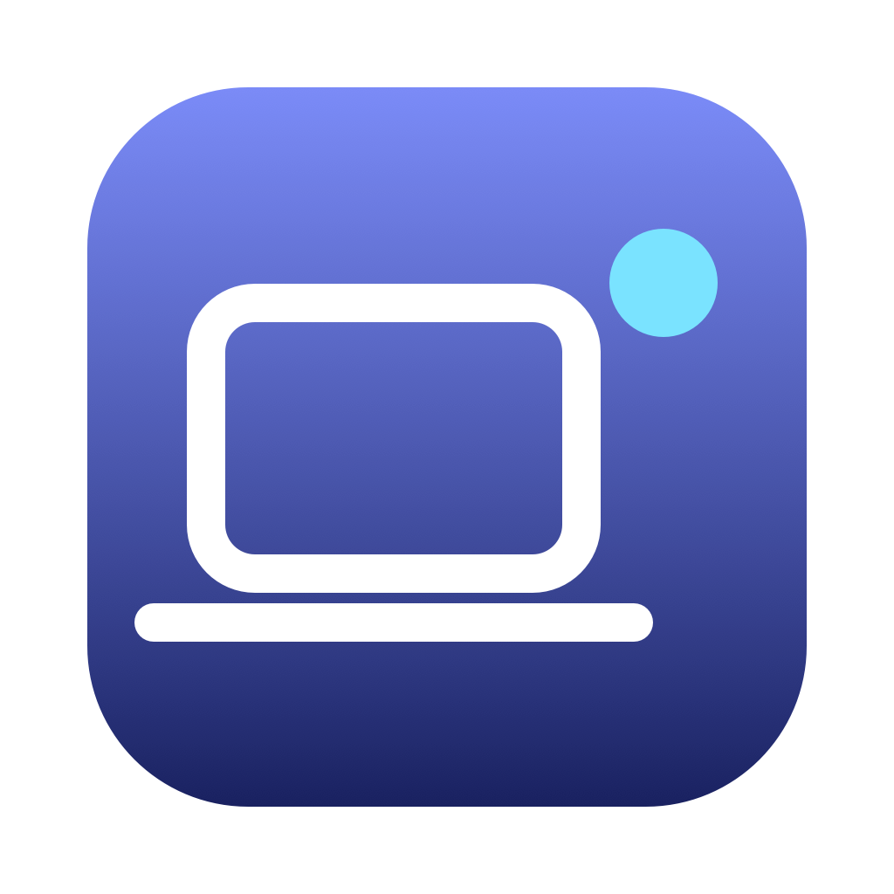

<div align="center">



# 守夜 · LidGuard

**合上盖子也不休眠** —— 并自动锁屏、延迟息屏。原生 Swift，无内核扩展、无常驻系统服务、不联网。

</div>

> A tiny macOS menu-bar app that keeps your MacBook awake with the lid closed,
> with automatic lock screen, delayed display-off, and verified restore, a watchdog, and low-battery protection.
> Native Swift · no kext · no daemon · no telemetry · Apple Silicon, macOS 13+

---

## 它解决什么问题

拿 Mac 当挂机机器时（跑长任务、给局域网其他设备提供代理），一合盖系统就睡眠，连接全断。

macOS 自带的「合盖模式」要求**外接显示器 + 电源 + 键鼠**，日常场景用不上；而手动敲 `pmset -a disablesleep 1`，既容易忘，也容易**忘了改回来**——机器就这么在包里亮着、热着、直到没电。

这个工具把这件事变成菜单栏上的一个开关，并提供**恢复状态确认、看门狗和低电量保护**。恢复依赖系统命令可执行与看门狗存活，无法覆盖所有强杀或系统故障。

## 功能

| 功能 | 说明 |
|---|---|
| 合盖不休眠 | 菜单栏一键开关，基于系统自带 `pmset -a disablesleep` |
| **合盖自动锁屏** | 检测到合盖后请求锁屏并回读会话状态；**接了外接显示器时自动跳过**（clamshell 属于正常桌面形态） |
| **锁屏后延迟息屏** | 可选 立即 / 15 秒 / 30 秒 / 1 分钟 / 3 分钟 / 不自动 |
| **接外接显示器时暂停**（可选，默认关） | 接入外接屏时自动暂停守夜，拔掉后自动恢复守护 |
| **恢复保护** | 正常退出先确认恢复；主进程消失由看门狗恢复；低电量自动尝试恢复 |
| **自愈巡检** | 每 15 秒核对一次系统状态，被外部改掉能自己修回来 |
| 电量兜底 | 未接电源且达到阈值时尝试恢复；失败明确提示并继续重试 |
| 不占 Dock | 只驻留菜单栏；**图标在 = 程序在跑** |

## 同类工具已经很多，为什么还做一个

这个品类**并不新**，社区里有上百个同类项目，商业产品也有好几个：

- **[Amphetamine](https://apps.apple.com/app/amphetamine/id937984704)**（App Store，免费）——最省事的选择
- **[Sleepless](https://github.com/Aboudjem/Sleepless)**（MIT）——思路与本项目最接近，源码很干净
- [Clamshell](https://clamshell.dev)（付费）、[KeepingYouAwake](https://github.com/newmarcel/KeepingYouAwake)、[Adrafinil](https://github.com/kageroumado/adrafinil)……

**如果你只需要「合盖不休眠」这一件事，直接用上面任意一个就好，不必装这个。**

这个项目的差异点只有三条，都很朴素：

1. **把「忘记关」当成主要风险来设计**——三重保险 + 每 15 秒自愈，而不是「设了就不管」；
2. **合盖 → 锁屏 → 息屏是一条完整链路**，不是三个彼此独立的开关；
3. **权限收窄到两条命令**，并且把「它到底能干什么」写清楚（见下方权限说明）。

## 系统要求

- **Apple Silicon** Mac（arm64）
- **macOS 13 Ventura** 及以上
- 使用安装包无需开发工具；自行编译需要 **Command Line Tools**（`xcode-select --install`）
- **不需要** Xcode 完整版，**不需要** Homebrew，没有任何第三方依赖

> 测试环境：MacBook Pro（M5 Pro）/ macOS 27.0.1。**未在 Intel Mac 上测试。**

## 安装

### 直接下载安装（推荐）

前往 [GitHub Releases](https://github.com/zyding123/shouye/releases/latest) 下载：

- **DMG**：打开 `Shouye-1.2-macOS-arm64.dmg`，把「守夜.app」拖到 Applications。
- **ZIP**：解压 `Shouye-1.2-macOS-arm64.zip`，把 App 移到「应用程序」后打开。
- 安装版只支持 Apple Silicon；无需 Xcode、Command Line Tools 或 Homebrew。`Source code` 为源码包，不是安装包。

如果正在合盖远程使用旧版，正常退出会恢复休眠，请先开盖再更新，避免远程连接中断。

### 从源码构建

```bash
git clone https://github.com/zyding123/shouye.git
cd shouye
./build.sh
open build/守夜.app
```

`build.sh` 会调用系统自带的 Swift 编译器生成 `.app` 并做 ad-hoc 签名。App 内包含独立命名的 `LidGuardWatchdog` 子进程。建议构建后把完整 `.app` 移到 `/Applications` 再开启登录启动；也支持其他稳定路径，但移动 App 后需要重新设置登录启动。

### 首次打开

因为未做 Apple 公证，首次打开会被 Gatekeeper 拦下：

先尝试打开 App，然后前往 **系统设置 → 隐私与安全性 → 找到被拦下的提示 →「仍要打开」**。仅在确认下载来源后允许运行，参见 [Apple 官方说明](https://support.apple.com/102445)。

## 使用

点菜单栏图标，菜单里依次是：

```
状态：守夜中 — 合盖不会休眠
────────────────
暂停（恢复合盖休眠）
────────────────
打开本工具时自动开启
登录时自动启动
电量低时自动恢复 ▸
────────────────
合盖时自动锁屏
合盖后息屏 ▸
接外接显示器时暂停
立即测试：锁屏 + 息屏
────────────────
它是怎么做到安全的…
安装或修复权限授权…（始终可见）
查看运行记录…
────────────────
退出（并恢复合盖休眠）
```

**菜单栏图标**：笔记本 + 实心圆点表示最近确认的开启状态，空心圈表示最近确认的关闭状态。无法读取、开启未成功或恢复失败时显示「待处理」及具体原因；不要仅凭圆点判断故障已经恢复。

## 权限说明（重要）

这是唯一需要授权的动作：

```bash
sudo pmset -a disablesleep 1   # 开启
sudo pmset -a disablesleep 0   # 恢复
```

首次运行时，通过**系统原生授权弹窗**直接执行固定安装逻辑。规则在管理员创建的临时目录内生成、验证和原子安装；不执行当前用户可改写的临时脚本，整体验证失败时回滚原规则。最终写入范围极窄的规则：

```
/etc/sudoers.d/lidguard-disablesleep
<当前用户名> ALL=(root) NOPASSWD: /usr/bin/pmset -a disablesleep 0, /usr/bin/pmset -a disablesleep 1
```

- 只允许这两条**完整命令**，**没有通配符**；其他任何 `pmset` 用法仍然需要密码
- 为什么需要：macOS 没有提供其他免特权的方式来改这个开关
- **如何撤销**：先暂停并确认恢复休眠，再删除该文件；重新安装只修复规则，不是撤销权限

### 它不做什么

- ❌ 不联网，**没有任何网络代码**
- ❌ 不收集数据、没有遥测
- ❌ 不写内核扩展，不需要关闭 SIP
- ⚠️ 唯一的后台进程是独立命名的 **`LidGuardWatchdog` 子进程**。
  开启前须通过就绪确认；主进程消失后，它尝试恢复并回读确认，失败则继续重试。
  新看门狗接管后，旧进程退出，避免旧恢复任务干扰新会话。

## 三重保险 + 自愈

| 场景 | 行为 |
|---|---|
| 点「退出」/ ⌘Q | 执行恢复并回读确认；失败时取消普通退出，保留恢复重试 |
| 注销 / 系统终止 | 尝试同步恢复；未完成时依赖仍存活的看门狗，无法保证系统不同时结束它 |
| **主进程被结束 / 崩溃** | 看门狗每 0.5 秒检查；发现主进程消失后恢复并确认，失败先快速重试，之后每 15 秒重试 |
| 未接电源且电量达到阈值 | 尝试恢复并确认；失败提示接电源和修复权限，不报告成功 |
| **系统状态被外部改回 0** | 用户仍要求开启时，每 15 秒巡检尝试重设并回读确认；低电量保护优先 |
| 登录后启动 | 根据自动开启设置尝试开启；启动重试耗尽后由巡检继续，用户取消可使旧重试失效 |

运行记录落盘在 `~/.lidguard/events.log`，菜单里也有「查看运行记录…」。看门狗依赖系统仍能执行命令；同时强杀主程序和看门狗、关机断电、系统无响应或权限被撤销时，不能保证立即恢复。不要在尚未确认恢复时先删授权规则。

## 实现要点（含踩坑）

代码不多（单文件约 960 行），但有几处不太显然的地方：

1. **读合盖状态**：`IOKit` → `IOPMrootDomain` 的 `AppleClamshellState`。
   每 2 秒读一次，纯内存操作，不起子进程。

2. **真锁屏**：调用私有接口 `SACLockScreenImmediate`（来自 `login.framework`）。

   > ⚠️ **这是最容易踩的坑**：该框架的二进制**只存在于 dyld 共享缓存里，磁盘上并没有文件**。
   > `ls` 会显示一个断链，`nm` 也读不到符号，很容易误判成「接口已被移除」。
   > 正确的判断方式是**直接 `dlopen`**，让缓存来解析：
   > ```swift
   > let h = dlopen("/System/Library/PrivateFrameworks/login.framework/Versions/A/login", RTLD_LAZY)
   > let sym = dlsym(h, "SACLockScreenImmediate")
   > ```
   > 附带一句：**在 macOS 上，永远不要用「文件是否存在」判断某个系统 API 有没有。**

3. **息屏**：`pmset displaysleepnow`，免管理员密码；且在 `disablesleep=1` 状态下**依然生效**
   （这一点用系统电源日志 `pmset -g log` 里的 `Display is turned off` 事件验证过）。

4. **意图与实际状态分开**：启动与巡检重试按用户当前意图运行；每次电源状态切换都回读确认。定时器加入 common modes，支持菜单跟踪与模态运行模式；命令执行有超时，但同步命令仍可能短暂推迟 UI。

5. **菜单栏图标**：`NSBezierPath` 直接画，`isTemplate = true` 自动适配深色/浅色菜单栏。

6. **构建绕开 Xcode 许可**：用 `/Library/Developer/CommandLineTools/usr/bin/swiftc`
   的绝对路径，并用 `MacOSX.sdk` 这个通用符号链接指向当前 SDK。
   （如果本机 Xcode 许可未接受，`/usr/bin/swiftc` 会拒绝工作，但 CLT 那份可以。）

### 诊断命令

```bash
./build/守夜.app/Contents/MacOS/LidGuard --lid          # 打印合盖状态
./build/守夜.app/Contents/MacOS/LidGuard --lockstate    # 打印是否已锁屏
./build/守夜.app/Contents/MacOS/LidGuard --lock-only    # 只请求锁屏、不息屏；accepted 不代表已确认
./build/守夜.app/Contents/MacOS/LidGuard --test-lock    # 确认锁屏后息屏，未确认则跳过
./build/守夜.app/Contents/MacOS/LidGuard --events       # 打印运行记录
./build/守夜.app/Contents/MacOS/LidGuard --force-off    # 把开关强制改回 0（测自愈用）
```

`tools/probe-lock.swift` 是一个独立探针，用来验证锁屏接口在当前系统上是否可用：

```bash
/Library/Developer/CommandLineTools/usr/bin/swiftc -o /tmp/probe tools/probe-lock.swift && /tmp/probe
```

## 回归测试

```bash
# 有独立 Command Line Tools 时
/Library/Developer/CommandLineTools/usr/bin/python3 tests/run-tests.py

# 仅安装完整 Xcode 时
SWIFTC="$(xcrun --find swiftc)" SDK_PATH="$(xcrun --show-sdk-path)" python3 tests/run-tests.py
```

测试从当前源码生成隔离副本，将电源写入、管理员执行、授权检查、登录项和用户偏好替换为模拟边界，不启动已安装 App。覆盖恢复失败、启动重试取消、锁屏确认、菜单/模态定时器、息屏状态、登录项回滚、脚本转义和命令超时；独立看门狗测试只结束唯一命名的测试进程，验证恢复重试及所有者交接。

GitHub Actions 在 macOS 上运行相同测试、构建并验证签名。自动化测试不替代真实合盖、低电量、注销或不同 macOS 版本的兼容性验证。版本变更见 [CHANGELOG.md](CHANGELOG.md)。

## 已知限制

- 使用了**私有 API**（`SACLockScreenImmediate`）来进入真正的锁屏界面，因此**不适合上架 Mac App Store**
- ad-hoc 签名、未公证，首次打开需要右键 → 打开
- **合盖时键盘面散热被遮挡**：适合挂机，不适合在包里跑重负载
- 只在 Apple Silicon + macOS 27 上实测过；更早系统理论上可用（目标 `macOS 13.0`），但未验证

## 卸载

1. 先从菜单退出，并确认成功恢复合盖休眠，再把 `守夜.app` 拖进废纸篓
2. 删除权限规则：`sudo rm /etc/sudoers.d/lidguard-disablesleep`
3. 若开过「登录时自动启动」：
   `launchctl bootout gui/$(id -u)/com.aries.lidguard && rm ~/Library/LaunchAgents/com.aries.lidguard.plist`
4. 可选：`rm -rf ~/.lidguard`（运行记录）

## 许可

[MIT](LICENSE) © 2026 zyding123

---

<sub>在 macOS 27.0.1 / Apple Silicon 上开发与测试。欢迎 issue，但不保证响应速度。</sub>
